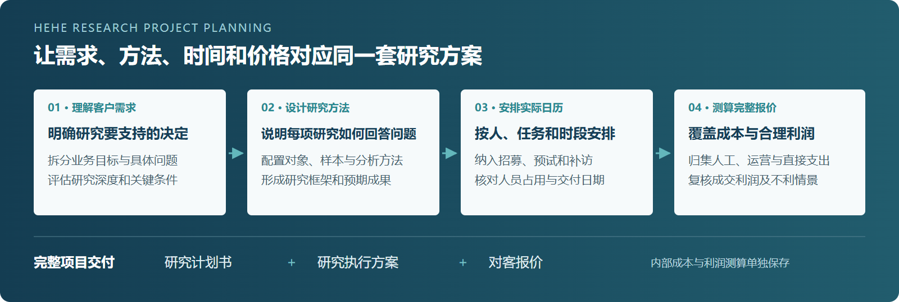
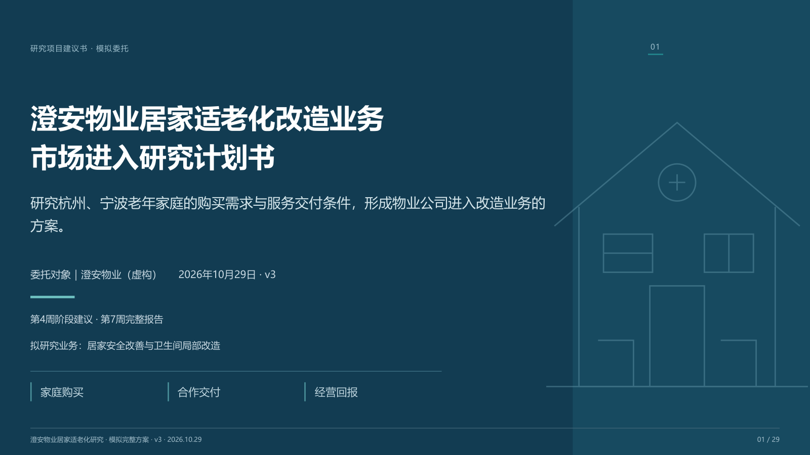
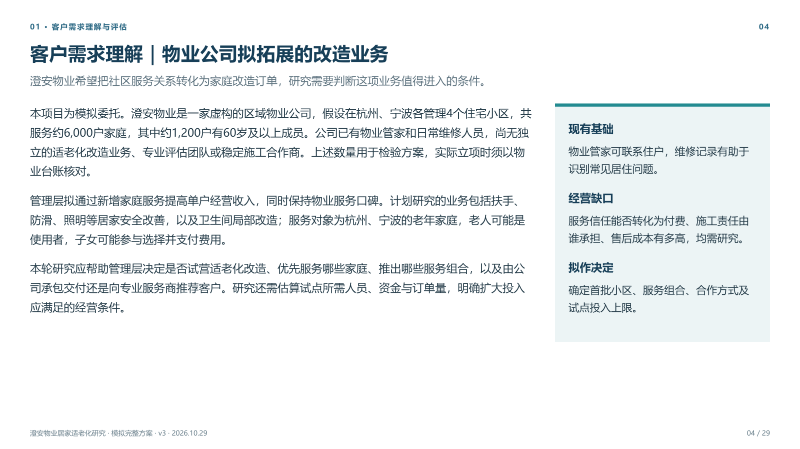
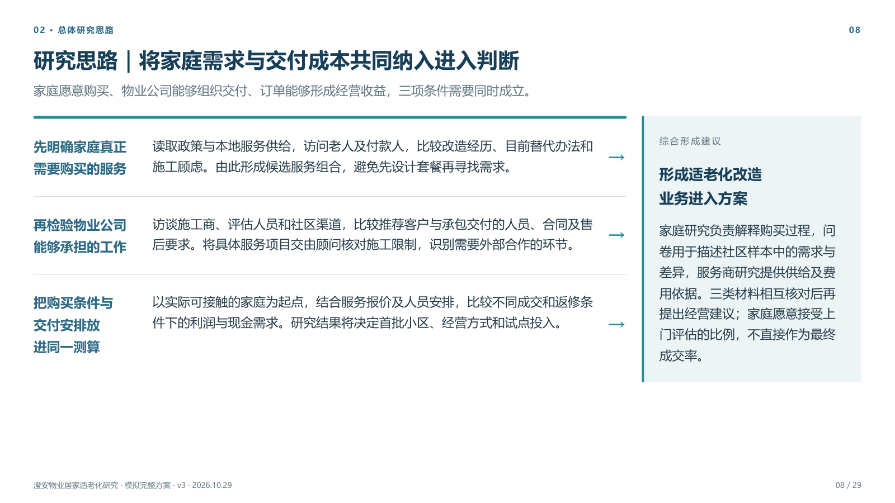
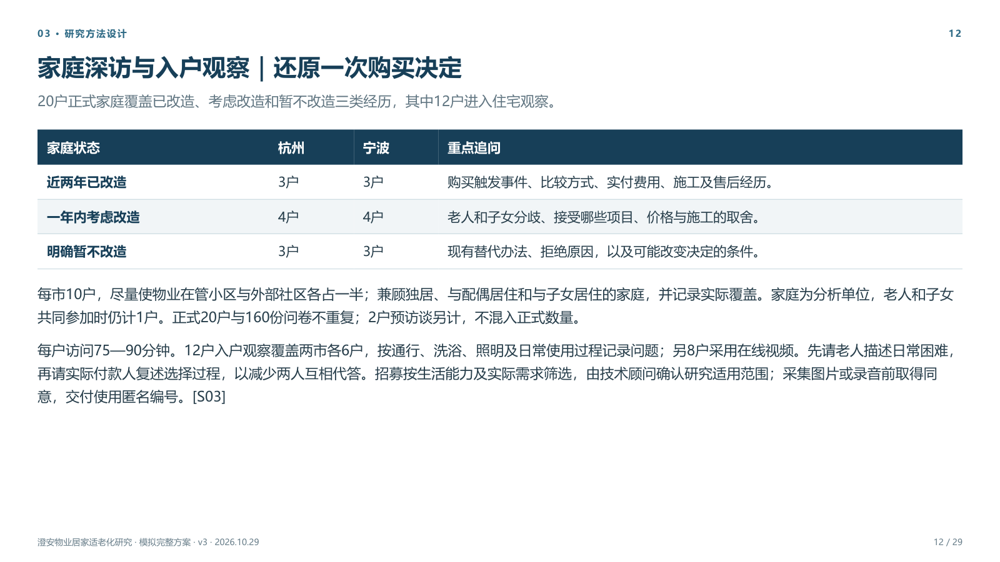
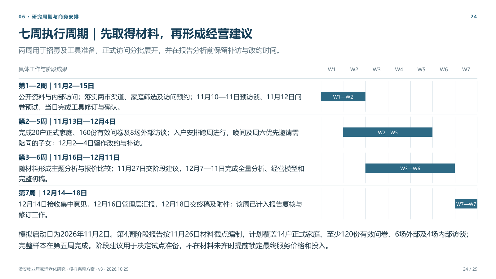
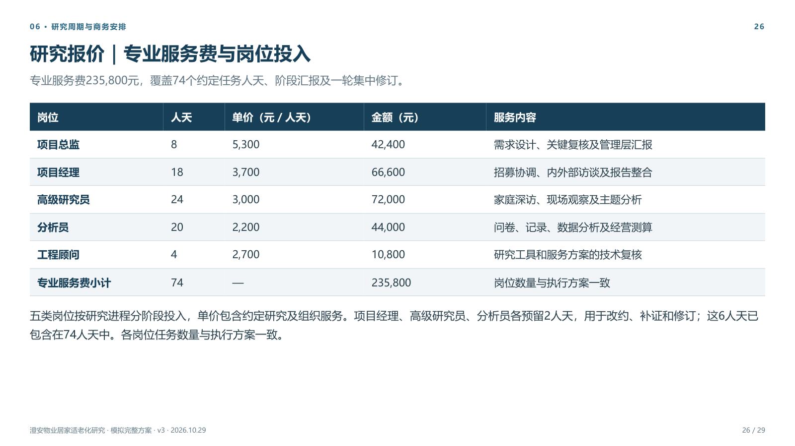
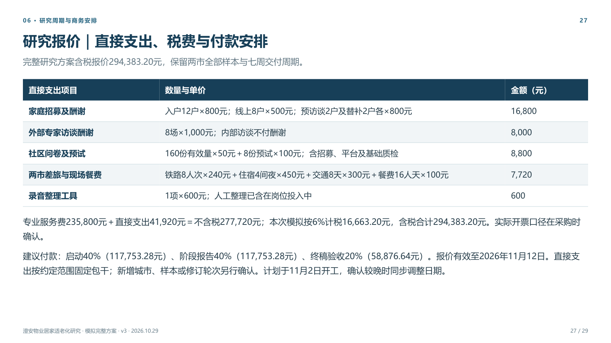

# 盒盒研究项目策划 Skill

> 把客户的研究需求，转为有方法、有执行安排、有合理报价的研究计划书。

[](LICENSE)
[](https://agentskills.io/)
[](CHANGELOG.md)
[](#安装)

**`hehe-research-project-planning` 是一项独立的研究项目策划 Skill。** 它帮助 Agent 理解客户希望作出的经营或投资决定，把需求拆成可研究的问题，设计研究方法与报告框架，再安排人员、招募、执行日历和费用。适用于行业研究、企业研究、用户研究、战略咨询、商业尽调、IPO 行业研究及白皮书项目。

你可以从一段客户的微信留言开始，也可以提供已有建议书、招标需求或研究方案。完整任务交付计划书、执行方案与报价；已有设计时，也能只做排期、报价或项目变更。

<p align="center">
  <a href="https://github.com/hexiaofeier/hehe-research-project-planning/releases/latest"><strong>📦 下载发布版</strong></a>
  &nbsp; · &nbsp;
  <a href="skills/hehe-research-project-planning/SKILL.md"><strong>📖 阅读 Skill</strong></a>
  &nbsp; · &nbsp;
  <a href="#计划书效果预览"><strong>🖼️ 查看计划书实图</strong></a>
  &nbsp; · &nbsp;
  <a href="#直接这样使用"><strong>🚀 开始使用</strong></a>
</p>

## 从客户需求，到可以讨论和执行的研究方案

研究项目的难点往往从开题就开始：客户说想“看看能不能做”，研究者需要进一步说明要判断什么、需要研究哪些对象、什么方法能回答，以及现有时间和预算能够支持多深的研究。

本 Skill 把这些工作连接起来，并让方案、排期和价格相互对应。



| 你需要处理的工作 | Skill 怎样展开 | 最终得到什么 |
|---|---|---|
| 客户需求比较口语化，目标和问题混在一起 | 交代委托方业务、拟进入市场和待作决定，拆分研究问题，评估研究深度与关键条件 | 客户能够理解和确认的需求说明 |
| 需要解释为什么这样研究 | 将行业、企业、用户或经营问题与方法连接，说明每个模块形成什么回答、如何支持选择 | 有具体研究思路的方法方案 |
| 需要把调研落到真实日历 | 逐项安排招募、预试、正式采集、补访、分析和反馈，核对人员与受访者可用时间 | 有依赖关系和实际容量依据的执行计划 |
| 需要形成能覆盖公司成本的报价 | 从全周期人员占用、薪酬、公司费用、直接支出与利润目标推算价格，再编对客明细 | 对客报价与单独保存的内部测算 |
| 客户调整样本、城市、期限或交付范围 | 评估变化影响，更新相应工作量、日历、费用与成果 | 前后对应的修改方案 |

## 五种入口，按这次任务的实际范围工作

| 你的请求 | 本次完成的内容 |
|---|---|
| **完整项目策划** | 需求评估、研究方法、研究框架、执行排期与报价；分别交付计划书、执行方案、对客报价及必要的内部测算 |
| **仅计划书或建议书** | 完成六部分计划书，核实人员、周期和费用可行性；正文汇总相应安排 |
| **已有方案，只排期** | 沿用研究设计，从工作包、资源、预约和现场条件安排执行日历 |
| **仅报价** | 使用已有研究设计，核实范围、工作量、人员占用与计价依据，形成报价 |
| **修改现有项目** | 根据原约定与实际进度，更新受变更影响的方案、时间或费用 |

行业、用户、战略咨询、投资/CDD、IPO、白皮书项目可以组合研究模块，并按各自用途设计成果。用户研究计划可以包含行业背景；商业尽调也可以同时研究市场、企业和采购客户。具体问题决定采用哪些模块。

## 完整计划书包含六个核心部分

| 章节 | 要让客户理解的内容 |
|---|---|
| **01 · 客户需求理解与评估** | 委托方的业务处境与目标，拟作出的决定，需求如何拆解，能够研究到什么程度，以及影响研究深度的条件 |
| **02 · 总体研究思路** | 每项研究解决什么问题，为什么选择这些方法，各模块如何联系，不同结果怎样影响下一步选择 |
| **03 · 研究方法设计详述** | 研究对象、样本与数量依据、采集内容、执行步骤、分析方法及质量检查 |
| **04 · 研究框架与最终报告结构** | 最终报告研究哪些板块、每块具体比较和解释什么，以及交付材料和使用方式 |
| **05 · 团队介绍与分工** | 岗位能力、实际投入、协作与复核关系，以及双方需要承担的工作 |
| **06 · 研究周期安排** | 各阶段时间、招募与执行窗口、交付节点、负责人及反馈安排；需要时附可独立抽取的报价 |

框架在理解客户目标、完成需求评估和方法设计后形成。方法、样本、周期与报价采用同一套项目范围，便于客户比较方案，也便于研究团队继续执行。

## 计划书效果预览

以下来自 **《澄安物业居家适老化改造业务市场进入研究计划书》v3**，为 29 页模拟项目建议书。委托方为虚构企业，研究覆盖杭州、宁波，计划第 4 周形成阶段建议、第 7 周交付完整报告。

本案例使用了可选的 `hehe-report-writing` 与 `hehe-report-presentation`。图片为客户版 PDF 原页渲染，展示需求理解、方法、周期与对客报价的实际组织方式；独立安装时采用随包基础 HTML 模板。点击图片可查看大图。

**查看完整样例：** [Markdown 计划书](examples/age-friendly-renovation/20261029_居家适老化_研究计划书_v3_定稿_CO.md) · [下载翻页 HTML](examples/age-friendly-renovation/20261029_居家适老化_研究计划书_v3_定稿_CO.html) · [29 页 PDF](examples/age-friendly-renovation/20261029_居家适老化_研究计划书_v3_定稿_CO.pdf) · [对客报价单](examples/age-friendly-renovation/20261029_居家适老化_对客报价_v3_CO.md)。HTML 下载到本地后用浏览器打开；PDF 与 HTML 放在同一文件夹，可使用页面内的 PDF 入口。

### 封面｜交代具体业务、研究对象与项目用途

[](docs/images/20261029_cover_CO.png)

### 需求与研究思路｜让客户理解研究将支持哪些经营决定

| 客户需求理解 | 总体研究思路 |
|:---:|:---:|
| [](docs/images/20261029_client-needs_CO.png) | [](docs/images/20261029_research-logic_CO.png) |

### 方法与周期｜具体到研究对象、样本安排和实际日期

| 家庭深访与入户观察 | 七周执行周期 |
|:---:|:---:|
| [](docs/images/20261029_interview-design_CO.png) | [](docs/images/20261029_schedule_CO.png) |

### 对客报价｜岗位服务、直接支出与付款安排分别列明

| 专业服务费与岗位投入 | 直接支出、税费与付款安排 |
|:---:|:---:|
| [](docs/images/20261029_service-quotation_CO.png) | [](docs/images/20261029_quotation-total_CO.png) |

**该模拟方案含税报价为 294,383.20 元。** 金额来自本案例的研究范围、人员安排和成本假设，用于展示报价的组织方式，不是市场统一收费标准。不同项目需按实际资源与服务条件重新测算。[查看展示案例说明](docs/20261029_展示案例说明_CO.md)。

## 排程考虑实际执行，报价覆盖完整服务

### 把工时、人员占用和项目周期分别算清

一场访谈的工作包括预约、准备、主持、记录、整理和后续分析；线下执行还要安排往返路程与现场时间。受访者可约时段、招募速度、场地和客户反馈都会影响项目完成日期。

Skill 分别检查三件事：

- **净工作量：** 完成每项任务需要多少工时。
- **实际占用：** 工作分散到哪些日期和时段，哪些时间被项目预约或专属服务锁定。
- **自然周期：** 任务何时能够开始，如何并行，何时取得材料并完成后续分析。

座谈会、线下拦截、入户访谈、到场体验、在线访谈和在线问卷分别采用对应的容量条件。招募、预试修订、改约、补访与客户反馈进入同一张日历；计划允许提前交阶段成果，同时为完整研究保留必要时间。

### 先测完整成本，再形成客户报价

报价从研究范围和全服务期人员安排出发。逐人逐周确认任务占用、额外锁定、可安排其他收费工作的时间和待确认容量，然后归集人员成本、公司公共费用、招募与样本等直接支出及执行预留。

```text
完整成本 = 人员占用成本 + 公司费用分摊 + 项目直接支出 + 执行预留
未税目标报价 = 完整成本 ÷（1 − 目标税前利润率）
```

人员成本会考虑工资、企业负担与年度可计费产能；公共费用覆盖实际适用的支持岗位、房租、软件等成本。参数优先采用企业资料，缺少资料时用明确假设比较情景，并核对重复分摊。

内部测算同时保留 **完整成本保本价、目标利润报价、拟成交价对应利润、不利情景下的利润**。确定价格后，再按采购需要编为岗位人天、工作包或固定项目报价。客户报价展示服务内容、数量、销售单价、直接支出和税费；内部工资与利润测算单独保存。

当完整范围超过客户预算时，保留原范围报价，再提供减少地区、样本、方法或成果的方案，并说明对应的研究取舍。

## 交付物与使用方式

| 交付物 | 主要用途 | 什么时候提供 |
|---|---|---|
| **Markdown 计划书** | 确认需求、研究思路、方法、成果和合作安排，继续编辑 | 完整计划书任务默认提供 |
| **16:9 翻页 HTML** | 向客户演示、会议讨论，浏览器离线阅读 | 完整计划书默认提供，用户可选择其他形式 |
| **PDF** | 固定版式、传阅和归档 | 随演示 HTML 导出并核验；制作端需具备 PDF 依赖 |
| **研究执行方案** | 细化工作包、依赖、人员与实际日历 | 完整策划或排期任务 |
| **对客报价单** | 采购确认、费用构成和付款安排 | 完整策划或报价任务 |
| **内部测算附件** | 复核人员占用、完整成本和利润 | 形成或复核价格时 |
| **Word／Excel 等附件** | 正式可编辑文稿、参数调整、方案比较与复杂计算 | 按用户要求和计算复杂度提供 |

计划书包含未来研究的安排与拟交付成果。正式访谈、问卷采集、统计分析及最终研究报告，在项目确认后另行开展。

## 独立运行，也能连接两个报告 Skill

本仓库提供 **1 个独立 Skill**，自带计划书 HTML 模板与生成器。两个报告 Skill 是可选增强，可分别从独立仓库安装；没有它们时，研究设计、文字定稿和基础 HTML 交付仍可完成。

| 已安装的报告能力 | 文字与分页 | 视觉交付 |
|---|---|---|
| **两个都未安装** | 本 Skill 自行成文、审校与逐页设计 | 随包 16:9 HTML，按依赖导出 PDF |
| **只有 `hehe-report-writing`** | 默认润色，翻页报告需要时使用分页模块 | 随包 16:9 HTML，按依赖导出 PDF |
| **只有 `hehe-report-presentation`** | 本 Skill 自行定稿与逐页设计 | 默认交给呈现 Skill 制作 16:9；选择下拉版时直接接收 Markdown |
| **两个都已安装** | 默认专业润色，按所选形式编排内容 | 呈现 Skill 制作选定形式；默认 16:9 |

安装呈现 Skill 后，Agent 会主动介绍 **16:9 横版、9:16 竖版、A4 竖版、带侧栏目录的下拉 HTML、可编辑 PPTX**。未选择其他形式时完成默认 16:9 版；已指定的要求直接沿用。单独排期、报价或局部修改时，先交付对应文件，需要增加视觉文件再确认。

## 安装

下载 [最新发布版](https://github.com/hexiaofeier/hehe-research-project-planning/releases/latest)，或克隆仓库：

```bash
git clone https://github.com/hexiaofeier/hehe-research-project-planning.git
```

将整个 **`skills/hehe-research-project-planning/` 文件夹** 放入客户端的 Skills 目录。保留 `SKILL.md`、`references/`、`assets/`、`scripts/` 和 `agents/`，然后新开会话。

| 客户端 | 常见用户级目录 | 调用示例 |
|---|---|---|
| Codex | `~/.codex/skills/` 或客户端配置目录 | `$hehe-research-project-planning` |
| Claude Code | `~/.claude/skills/` | `/hehe-research-project-planning` |
| 其他支持本地 Agent Skills 的客户端 | 客户端指定的 Skills 目录 | 在 Skill 列表中选择或按客户端方式调用 |

安装后目录应是 `<Skills 目录>/hehe-research-project-planning/SKILL.md`。更新时替换同名完整目录，保留自己另存的项目成果；同名 Skill 安装一份即可。

### 依赖按交付格式准备

| 本次工作 | 制作端环境 |
|---|---|
| 需求评估、方法设计、Markdown 计划书与报价 | 可读取本地 Skill 的 Agent；必要预研使用当前可用的搜索与文件工具 |
| 随包页面 JSON → 16:9 HTML | Python 3.10+ 标准库，无第三方 Python 包 |
| 随包 HTML → PDF | Python 3.10+、Playwright、Chromium，或通过 `--browser` 指定本机兼容浏览器 |
| PDF 实际页面检查 | 可用的 PDF 阅读或渲染工具 |
| 增强版 HTML／可编辑 PPTX | 按可选 [呈现 Skill 的依赖说明](https://github.com/hexiaofeier/hehe-report-presentation#使用与依赖) 准备 |

PDF 路径可按仓库 [依赖文件](requirements-pdf.txt) 准备：

```bash
python -m pip install -r requirements-pdf.txt
python -m playwright install chromium
```

已有可用 Chromium 系浏览器时，可由 Agent 使用 `--browser` 指向它，复用现有安装。没有 Python 时也可直接填充随包 HTML 模板；缺少 PDF 依赖时先交付 Markdown 和 HTML，并列明尚未生成的 PDF。

依赖安装在制作文件的电脑或服务器上。收到成果的人使用浏览器或 PDF 阅读器即可查看；可编辑 PPTX 使用相应演示软件。

## 直接这样使用

### 从客户需求开始，制作完整研究方案

```text
使用 $hehe-research-project-planning 做一个完整研究项目策划。

我们是一家区域物业公司，计划在杭州、宁波开展居家适老化改造服务。
需要判断优先服务哪些家庭、提供哪些项目、采用自营还是合作方式，
以及试点需要投入多少、什么条件下值得扩大。

先集中确认影响方案的关键条件，再交付计划书、执行方案与报价。
客户希望第4周看到阶段建议、第7周看到完整报告。
报价按真实人员占用、完整公司成本与利润目标测算。
计划书采用16:9翻页HTML和PDF，正文和研究方法充分展开。
```

### 只准备给客户看的建议书

```text
使用 $hehe-research-project-planning，根据这份客户需求写研究建议书。
先说明客户要作出的决定、需求拆解及研究深度，
再解释研究思路、方法、报告框架、团队和周期。
本轮只做计划书，交付Markdown与默认16:9 HTML。
```

### 沿用已有方案，重新排期与报价

```text
使用 $hehe-research-project-planning，复核这份研究方案的排期和报价。
沿用已确认的研究目标与方法，核对招募、用户可约时间、线下路程、
预试、补访、分析和客户反馈，形成实际日历。
再按逐人逐周占用、公司完整成本和目标利润核算，
交付执行方案、对客报价与单独保存的内部测算。
```

## 2026.10.29 · 独立公开版

本版集中提供需求评估、方法设计、研究框架、实际排程、完整成本报价和计划书交付能力，包含 **10 份方法与交付参考、随包 HTML 模板和 PDF 导出脚本**。

- **研究方案更具体：** 六部分内容覆盖客户需求、研究思路、方法、成果、团队和周期；针对不同研究类型调整内容。
- **排程与成本相互对应：** 依据任务和实际占用安排人员，并检查公司费用分摊、成交利润和不利情景。
- **报告增强可选：** 按四种安装组合运行，缺少写作或呈现 Skill 时采用随包能力。
- **客户表达与视觉交付同时检查：** 主副标题与正文围绕同一主题，保留完整解释，图形用于展示方法关系、样本结构和排期。

本轮以适老化改造模拟项目验证了计划书、执行方案、报价和 29 页 HTML/PDF 的对应关系，并单独验证随包 HTML/PDF 生成路径。案例说明与脚本检查各自对应实际测试范围。详细版本记录见 [CHANGELOG](CHANGELOG.md)。

## 可选搭配

| 仓库 | 配合方式 |
|---|---|
| [盒盒专业报告写作与润色](https://github.com/hexiaofeier/hehe-report-writing) | 对已完成方案进行专业编辑、去AI味和逐页编排 |
| [盒盒商业报告呈现](https://github.com/hexiaofeier/hehe-report-presentation) | 制作多形态 HTML、PDF 与可编辑 PPTX |
| [盒盒行业研究技能包](https://github.com/hexiaofeier/hehe-industry-research-skill-pack) | 在实际研究阶段开展公开信息行业与企业研究；按具体任务另行使用 |

欢迎通过 [Issues](https://github.com/hexiaofeier/hehe-research-project-planning/issues) 提交执行问题、案例反馈或改进建议。本项目采用 [MIT License](LICENSE)。
